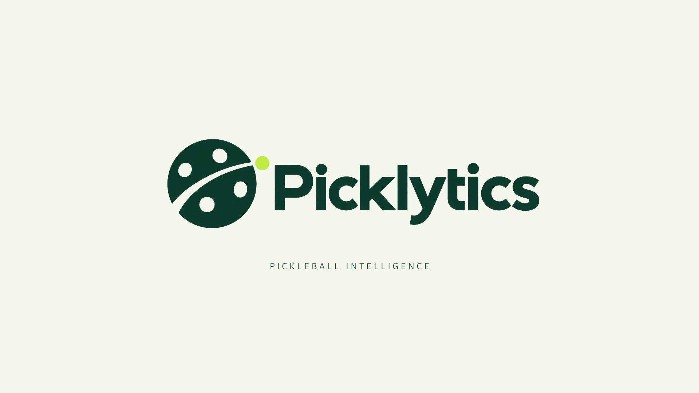
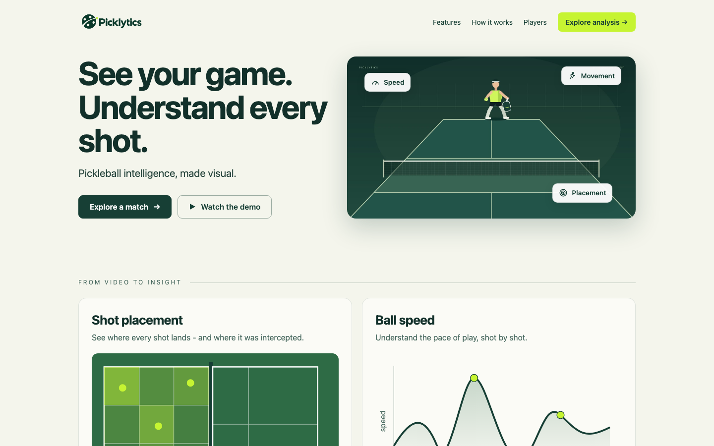
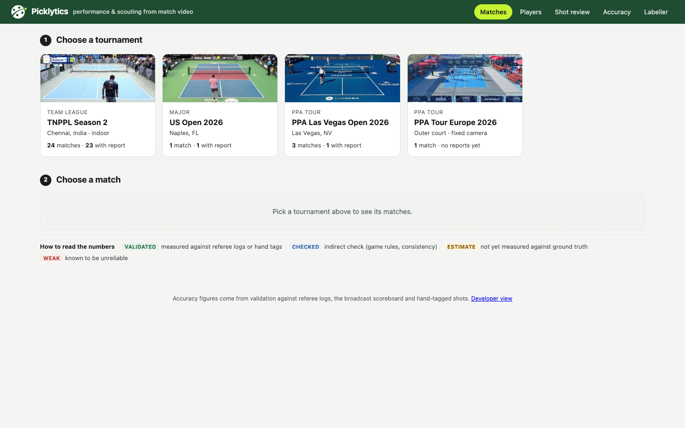
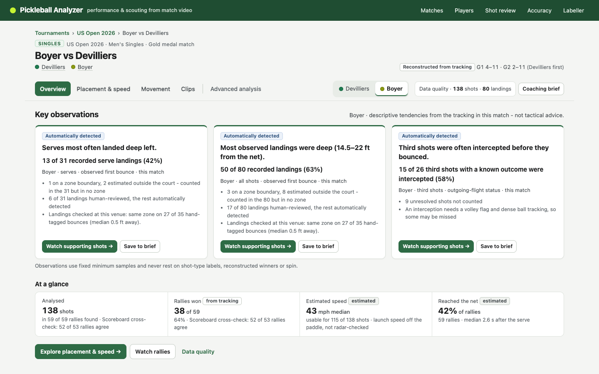
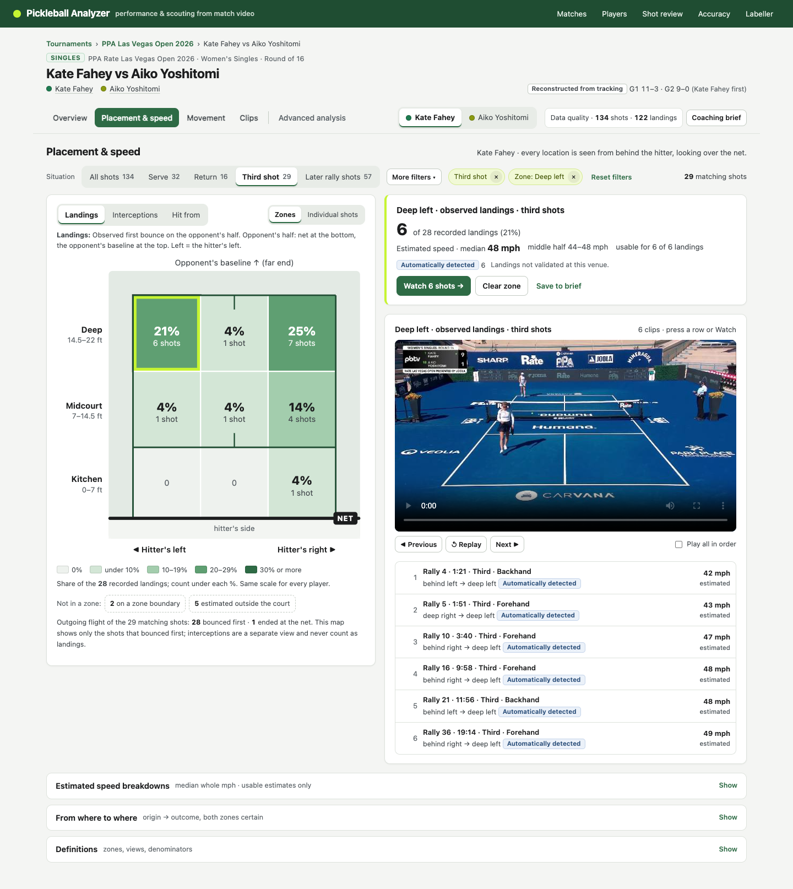

<p align="center">
  
</p>

<p align="center"><b>Pickleball intelligence, made visual.</b><br>
Performance analysis and opposition scouting from ordinary match video.</p>

<p align="center">
  
  
  
  
  
</p>

> 🚧 **Still in development.** The tracking pipeline and dashboard work end to end on real tournament footage, but accuracy work, more venues and new features are ongoing. Numbers below are from held-out, hand-checked tests.

**▶ Intro video:** [`dashboard/brand/picklytics-intro.mp4`](dashboard/brand/picklytics-intro.mp4) (6 s)



## What it is

Picklytics turns a match video into the kind of analysis coaches and analysts use in cricket and football (Hudl / Sportscode style), built for pickleball:

- **Ball tracking:** a YOLO11 single-frame detector plus a temporal heat-map detector trained on 25k physics-verified frames, with a 3D flight model for bounces and landing spots.
- **Players and court:** player tracking and pose, 12 court keypoints, and a camera model that maps everything onto a 20 × 44 ft top-down court.
- **Events and shots:** hits, bounces, rallies, serves, returns, third shots, dinks, drives, drops and lobs, plus forehand vs backhand.
- **Scoring:** reads the broadcast score bug and reconstructs who won each rally.
- **Coach view:**
  - Per-player key observations, each with its sample size.
  - Shot placement by zone and estimated ball speed.
  - Movement heatmaps.
  - A clips library: every number links to the video moments behind it.
  - A printable coaching brief.

Every figure is labelled **validated** (checked against referee logs or hand tags), **checked**, or **estimate**, so nothing claims more accuracy than it has.

## Matches analysed

| Tournament | Matches | What's covered |
|---|---|---|
| **TNPPL Season 2**, Tamil Nadu Pickleball Premier League (Chennai, indoor) | 24 | Three team ties: Kodai Tigers vs Rockfort Terminatrz Trichy, Salem Super Smashers vs Twin Eagles Hosur, Ramnad Royals vs Coimbatore Smashers. Each tie has men's singles, women's doubles, men's doubles, mixed doubles, men's 50+ doubles, and the team super doubles and super singles events. |
| **US Open 2026** (Naples, FL) | 1 | Men's singles gold medal match, Boyer vs Devilliers. Scoreboard cross-check: 52 of 53 rallies agree. |
| **PPA Las Vegas Open 2026** | 3 | Women's singles R16 (Kate Fahey vs Aiko Yoshitomi), mixed doubles semifinal and quarterfinal. Rally winner 96% right against the referee log. |
| **PPA Tour Europe 2026** | 1 | Full-day outer-court feed from a fixed camera (about 3 doubles matches). |

29 matches in total: singles, doubles, mixed, 50+ and team formats, on four different courts and camera setups.



## Screenshots

| Match overview | Placement & speed |
|---|---|
|  |  |

More in [`docs/ui_redesign/`](docs/ui_redesign/).

## Results so far

Ball detection, tested on 12 hand-labelled rally clips (1,784 frames, every ball position clicked by hand, several from matches never used in training):

| System | F1 within 8 px |
|---|---|
| YOLO11 single-frame detector + path search (baseline) | 84.6% |
| Temporal heat-map detector, round 2 | **90.1%** |

Adding venue-specific footage lifted US Open recall from 64% to 96%, so venue coverage matters more than model size. The full write-up, with confidence intervals, error breakdown and the physics layer, is in [`docs/RESULTS.md`](docs/RESULTS.md).

## Run it

```bash
pip install -r requirements.txt
cp .env.example .env                          # add your own Roboflow key to download training data
python3 analyze.py "path/to/match.mp4" --names P1=Devilliers,P2=Boyer
python3 serve.py                              # then open http://127.0.0.1:8001/dashboard/
```

Pipeline: `pickleball/detect.py` (models → detections) → `pickleball/analysis.py` (players, ball track, hits/bounces, rallies, shots, stats) → `training/build_report.py` (coach report) → `dashboard/`.

Full commands for training, labelling and scoring are in [`docs/USAGE.md`](docs/USAGE.md). Training scripts live in `training/`, and the GPU jobs (Kaggle T4) are in `kaggle_jobs/` and `colab/`.

## Data (not included)

No match videos or training datasets are stored in this repo.

- **Match footage:** public broadcast and stream footage of TNPPL Season 2, the US Open 2026, the PPA Las Vegas Open 2026 and PPA Tour Europe 2026. Rights stay with the leagues and broadcasters.
- **Training datasets** (Roboflow Universe, CC BY 4.0):
  - [Pickleball Vision](https://universe.roboflow.com/liberin-technologies/pickleball-vision) (Liberin Technologies)
  - [Pickleball](https://universe.roboflow.com/pickleball-1uztf/pickleball-uninu)
  - [Pickleball Court keypoints](https://universe.roboflow.com/necromancer/pickleball-court-vbmkq) (necromancer)
- **Shot data:** [pklmart's Competitive Pickleball Extracts](https://www.kaggle.com/datasets/cakesofspan/pklmarts-competitive-pickleball-extracts) on Kaggle (CC BY-NC-SA, non-commercial), used for the experimental shot classifier.
